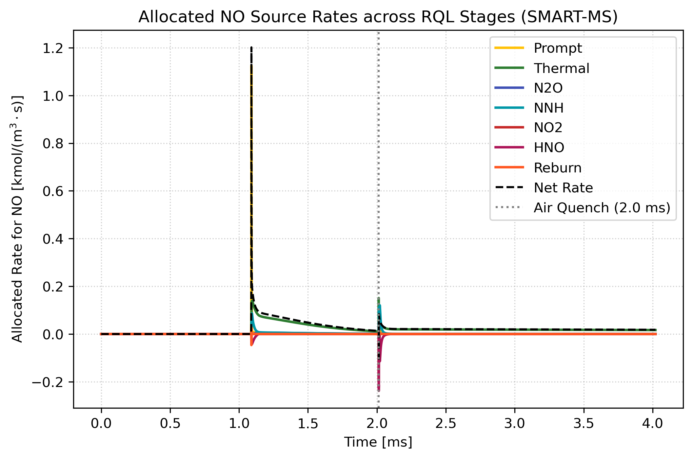
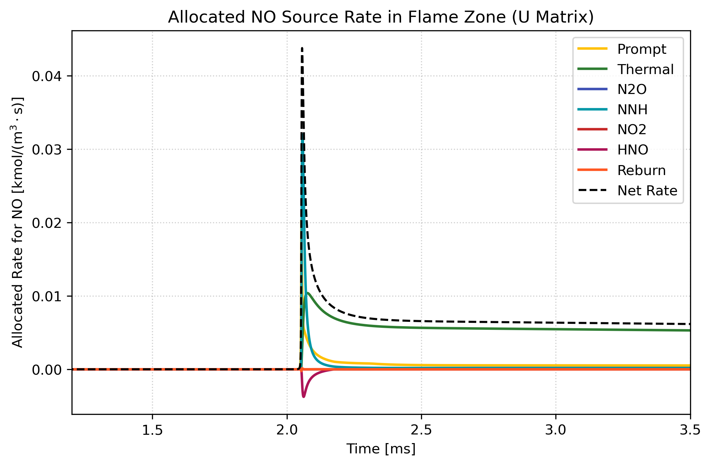
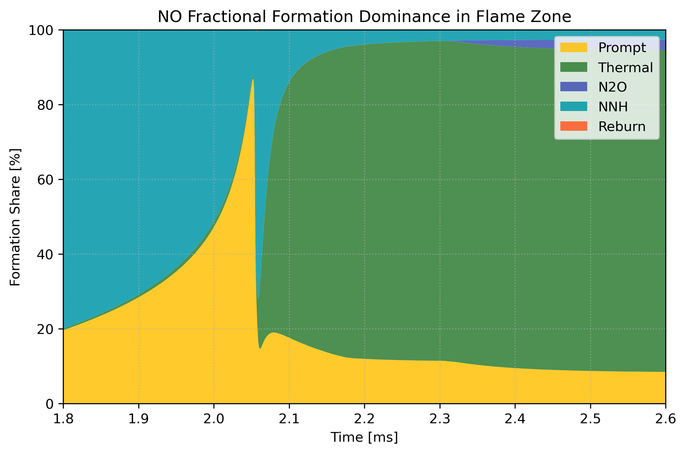
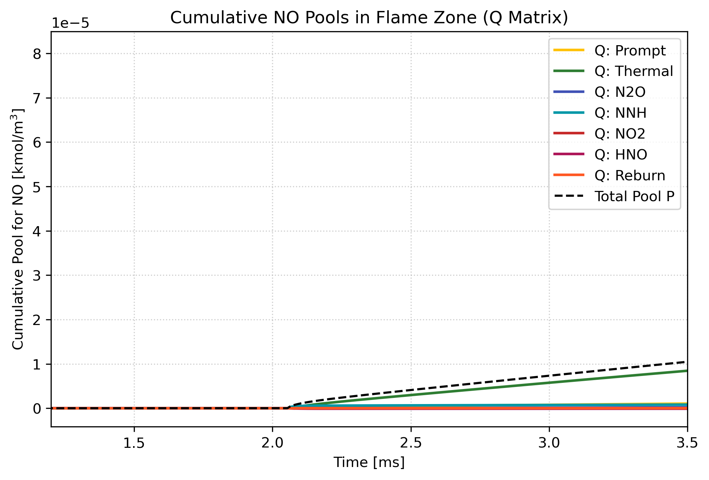
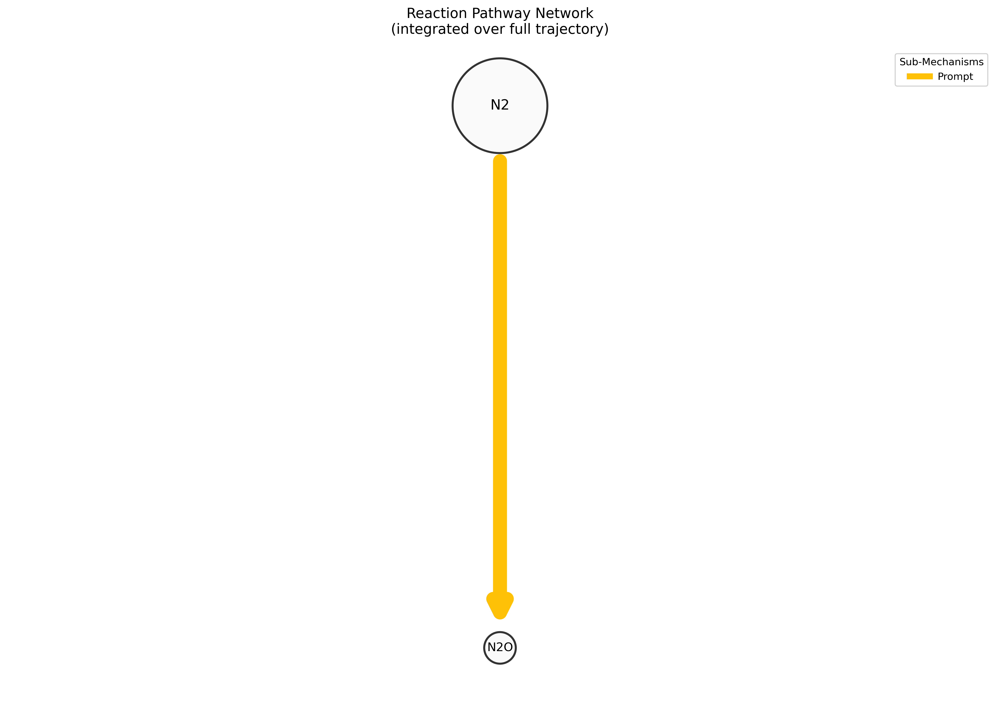
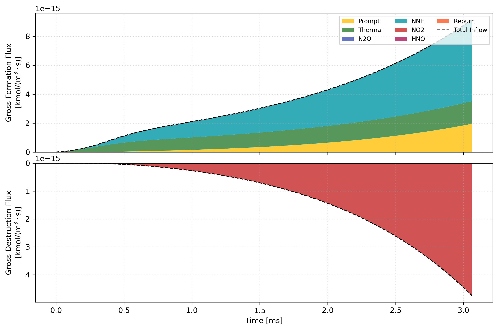
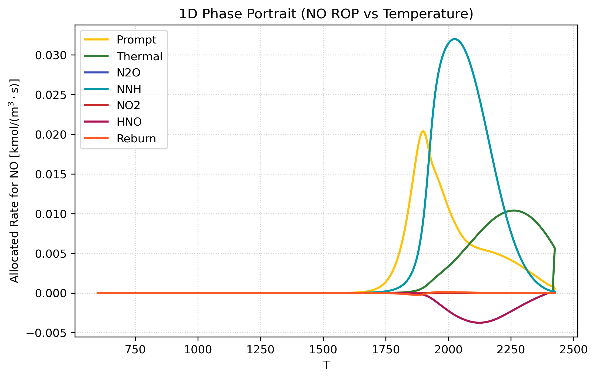

# pySMART: Sub-Mechanism Accounting and Reaction Tracing

[](https://opensource.org/licenses/MIT)
[](https://www.python.org/downloads/)

`pySMART` is an open-source Python library for **reaction pathway analysis** in reacting flows and chemical kinetics. It attributes pollutant formation and destruction to distinct physical pathways (e.g., Thermal Zeldovich, Prompt Fenimore, Reburn, Fuel-N oxidation, DeNOx) on unmodified kinetic simulations.

This package includes:
- **Base SMART Algorithm**: Graph-based element tracking and pathway source allocation for closed systems. Enhanced with algorithmic refinements that reduce convergence iterations by over 70% and guarantee strict mass conservation.
- **SMART-MS**: Exact mass conservation and discrete boundary jump tracking across multi-stage combustors.
- **SMART-MG**: Hierarchical 3-level domain decomposition parallel solver (up to $109\times$ speedup on detailed mechanisms like Glarborg 2018).


> **Theoretical Foundations:** For the full mathematical derivations of graph element tracing, Case 1–4 allocations, SMART-MS mixing jump operators, and SMART-MG domain decomposition, please refer to:
> - Patel, S. (2026). *Doctoral Thesis: Modeling and Kinetic Analysis of Axially Staged Combustion Systems*, Chapter 2 & Appendix B.
> - Helbig, H., & Bohon, M. D. (2024). *A novel method for quantifying variations in NO formation pathways in combustion systems: Sub-mechanism accounting and reaction tracing (SMART)*. Combustion and Flame, 260, 113228.

---

## 1. Installation

Install directly from source in editable mode:

```bash
git clone https://github.com/spatel472/pysmart.git
cd pysmart
pip install -e .
```

### Dependencies
- Python >= 3.9
- `cantera >= 3.0.0`
- `numpy`, `scipy`, `pandas`, `numba`, `matplotlib`, `networkx`

---

## 2. Input Data Format

`pySMART` operates on a standard `pandas.DataFrame` representing any reacting flow trajectory (Cantera 0D reactor, 1D laminar flame, or CFD extraction).

The DataFrame must include:
1. **`time`** (or custom `time_col`): Continuous time in seconds $[s]$.
2. **`T`**: Temperature in Kelvin $[K]$.
3. **`P`**: Pressure in Pascals $[Pa]$ (or pass `fallback_pressure_pa` to `smart.analyze`).
4. **Species Fractions**: Mass fractions (`Y_NO`, `Y_O2`, ...) or mole fractions (`X_NO`, `X_O2`, ...) matching species in your Cantera mechanism file.
5. **`stage`** *(Optional, for multi-stage systems)*: Integer or string column denoting reactor stages (e.g., `1, 1, ..., 2, 2, ...`).

---

## 3. Quickstart: Single-Stage Reaction Pathway Analysis

```python
import pandas as pd
import pysmart as smart

# 1. Load your trajectory DataFrame
df = pd.read_csv("my_trajectory.csv")

# 2. Run pathway analysis
result = smart.analyze(
    df=df,
    mech="gri30.yaml",          # Cantera mechanism
    time_col="time",            # Time column name
    tracked_element="N",        # Element to track ('N', 'C', etc.)
    target_species="NO",        # Target pollutant of interest
    multigrid=True,             # Enables parallel SMART-MG solver
    n_workers=4                 # Number of parallel workers
)

# 3. View cumulative yields table
df_yields = result.get_cumulative_yields(target="NO")
print(df_yields)

# 4. Plot time-resolved allocated pathway rates (U matrix)
fig, ax = result.plot_rates(target="NO", t_ms=True)
fig.savefig("quickstart_rates_no.png", dpi=300, bbox_inches="tight")
```

**Example Output Table:**
```
sub_mechanism  formation_yield  destruction_yield     net_yield  formation_share_%
       Prompt     1.69e-05           0.00e+00          1.69e-05              15.5%
      Thermal     2.97e-05           0.00e+00          2.97e-05              27.1%
          NNH     6.28e-05           0.00e+00          6.28e-05              57.4%
          NO2     0.00e+00           3.84e-06         -3.84e-06               0.0%
```

### The $U$ Allocation Time History: Pinpointing Kinetic Mechanisms
The **Allocated Net Source Rate ($U_{i,k}$)** is the core diagnostic metric of the SMART framework (demonstrated in [`examples/01_single_stage_premixed.py`](examples/01_single_stage_premixed.py)). Unlike conventional reaction-rate grouping (which fails when intermediate radicals are shared across pathways), $U$ traces true atomic provenance forward from initiation reactions:

<p align="center">
  
</p>

- **Flame Front vs. Post-Flame Separation:** The prompt Fenimore route (gold) and $\ch{NNH}$ pathway (cyan) exhibit sharp, transient spikes confined strictly to the high-radical ignition front ($t \approx 0\text{--}0.1\,\mathrm{ms}$).
- **Post-Flame Thermal Domination:** As intermediate radicals decay and high post-flame temperatures are reached, the thermal Zeldovich mechanism (green) rises rapidly and accounts for all ongoing post-flame $\ch{NO}$ formation.
- **Mass Closure Verification:** The black dashed line shows the sum of all allocated sub-mechanism pathways ($\sum_k U_k$). Its closure verifies exact mass conservation across the entire trajectory.

---

## 4. Multi-Stage Staged Combustion (SMART-MS)

In staged systems (such as primary stoichiometric flame $\to$ secondary fuel/air injection), fresh streams physically dilute carry-over gases and introduce new reactants. 

To enable **SMART-MS** boundary jump tracking and proportional pool dilution (demonstrated in [`examples/02_multistage_staged_combustion.py`](examples/02_multistage_staged_combustion.py)), simply include the `stage_col` parameter:

```python
result = smart.analyze(
    df=df,
    mech="gri30.yaml",
    time_col="time",
    tracked_element="N",
    target_species="NO",
    stage_col="stage",          # Automatically evaluates Delta P_i^mix across stages
    multigrid=True,
    n_workers=8
)
```

`pySMART` automatically:
- Identifies stage boundaries where `df['stage']` transitions.
- Evaluates discrete concentration jumps: $\Delta P_i^{\mathrm{mix}} = [X_i]_{\mathrm{entry}}^{(s+1)} - [X_i]_{\mathrm{exit}}^{(s)}$.
- Assigns fresh mass additions to the dedicated `Staged Mixing` pathway.
- Proportionally contracts pre-existing pools for accurate Case 3 drawdown accounting.

```python
# Plot allocated rates across both stages
fig, ax = result.plot_rates(target="NO", t_ms=True)
ax.axvline(2.0, color="gray", linestyle=":", label="Stage Boundary")
fig.savefig("multistage_rates_no.png", dpi=300, bbox_inches="tight")
```

<p align="center">
  
</p>

- **Stage 1 (Rich Zone, $\phi = 1.35$):** Fuel-rich combustion produces high concentrations of prompt $\ch{NO}$ and intermediate carbon monoxide ($\sim 7.6\%\,\ch{CO}$) at reduced oxygen availability.
- **Quench Interface ($t = 2.0\,\mathrm{ms}$):** Secondary air injection immediately dilutes local concentrations ($\Delta P_i^{\mathrm{mix}}$). SMART-MS accounts for oxidizer inflow and contracts existing pools by the exact dilution factor.
- **Stage 2 (Lean Burnout, $\phi = 0.70$):** Additional thermal $\ch{NO}$ forms as secondary oxygen burns the remaining $\ch{CO}$, while SMART-MS maintains exact mass closure across the transition.

---

## 5. High Performance Architecture: Multi-Grid (SMART-MG) & Numba JIT Compilation

Evaluating reaction pathways across stiff combustion trajectories can be a severe computational bottleneck ($\mathcal{O}(N_L \cdot N_{\mathrm{sp}}^2 \cdot N_{\mathrm{mech}} \cdot N_{\mathrm{iter}})$). For comprehensive mechanisms like Glarborg 2018 (83 nitrogen-bearing species, 1,395 reactions), an unaccelerated serial trajectory solve can take 2.5 to 15 hours.

`pySMART` solves this via a two-tier acceleration architecture:

### 5.1 Native Numba JIT Compilation (`@njit(cache=True)`)
- **C-Speed Inner Loops:** The core algebraic allocation kernels (`allocate_flux`, `calculate_allocation_factor`, and `allocate_pool`) in `solver_serial.py` are compiled to machine code using Numba JIT.
- **Identical JIT Kernels Across Parallel Workers:** In multi-grid mode (`multigrid=True`), every asynchronous chunk worker calls the exact same Numba JIT-compiled kernel on its assigned local time slice. With `cache=True`, workers load pre-compiled binaries from disk without compilation lag.
- **Zero Python Overhead:** Inner time-stepping loops run without Python interpreter or GIL intervention.

### 5.2 Hierarchical 3-Level Multi-Grid Domain Decomposition (SMART-MG)
When `multigrid=True` is enabled:
1. **Level 0 (Serial Coarse Warmup):** A single coarse forward pass ($M_{\max,0} = 3$) pre-conditions pathway allocation ratios ($\boldsymbol{\nu}_{i,k}^{(0)}$), establishing accurate flame front locations in $< 1\,\mathrm{s}$ and cutting outer iterations by $>70\%$.
2. **Level 1 (Parallel Subdomain Smoothing):** The trajectory is partitioned into $P$ chunk subdomains across a `ProcessPoolExecutor`. Each worker executes the JIT kernel over its local slice concurrently.
3. **Level 2 (Global Synchronization):** The master thread aggregates scalar integrals $\sum_p \mathcal{I}_F^{(p)}$ and $\sum_p \mathcal{I}_G^{(p)}$ to synchronize global correction factors $\boldsymbol{\nu}_{i,k}$. Because scalars are tiny ($83 \times 11 \approx 900$ floats), communication overhead is $< 0.02\,\mathrm{s}$.

This delivers up to a **$109\times$ speedup** (reducing 2.5-hour serial runs to $82.6\,\mathrm{s}$ on 8 cores) while eliminating the need for lossy trajectory downsampling.

### 5.3 Benchmarked Performance Across Workstation Cores
Evaluated on a dense multi-stage combustion trajectory ($N_L = 1{,}713$ adaptive steps, Glarborg 2018 mechanism with 83 nitrogen species):

| Configuration | Cores / Workers ($P$) | Total Solve Time | Parallel Speedup | Max Pathway Error |
| :--- | :---: | :---: | :---: | :---: |
| **Serial Un-accelerated (Reference)** | 1 | $\sim 9{,}000\,\mathrm{s}$ (2.5 hr) | $1.0\times$ | $0.00\%$ (Ref) |
| **SMART-MG (Level-0 Warmup + 1 Core)** | 1 | $184.7\,\mathrm{s}$ | **$48.7\times$** | $< 10^{-11}\%$ |
| **SMART-MG (Multi-Grid Parallel)** | 4 | $117.5\,\mathrm{s}$ | **$76.6\times$** | $< 10^{-11}\%$ |
| **SMART-MG (Multi-Grid Parallel)** | 8 | **$82.6\,\mathrm{s}$** | **$109.0\times$** | $< 10^{-11}\%$ |
| *Naive Serial Downsampling ($N_L = 51$ pts)* | 1 | $81.4\,\mathrm{s}$ | *Misleading* | **$31.2\%$ Error** |

> **Why Not Just Downsample?** Coarsely downsampling stiff chemical trajectories to 50 points cuts solve times but introduces up to **31.2% integrated pathway error** by clipping narrow radical peaks ($\Delta t_{\text{flame}} \sim 50\,\mu\mathrm{s}$) in the ignition front. SMART-MG solves the full un-downsampled grid in 82 seconds with zero numerical clipping.

---

## 6. Complete Visualization Suite

All plots are accessible directly from the returned `SMARTResult` object:

### 6.1 Allocated Pathway Rates ($U_{i,k}$)
Time-resolved formation and destruction rates for each sub-mechanism:
```python
fig, ax = result.plot_rates(target="NO", t_ms=True)
fig.savefig("rates_no.png", dpi=300)
```
<p align="center">
  
</p>

### 6.2 Fractional Formation Dominance Stackplot ($S_{i,k}^+$)
Time-resolved percentage share of ongoing pollutant formation:
```python
fig, ax = result.plot_dominance(target="NO", t_ms=True)
fig.savefig("dominance_no.png", dpi=300)
```
<p align="center">
  
</p>

### 6.3 Cumulative Accounting Ledgers ($Q_{i,k}$)
Cumulative running pools tracking the net historical contribution of each pathway:
```python
fig, ax = result.plot_pools(target="NO", t_ms=True)
fig.savefig("pools_no.png", dpi=300)
```
<p align="center">
  
</p>

### 6.4 Reaction Pathway Network Graph
Publication-ready directed graph showing species nodes (scaled by concentration) and pathway edges (colored and weighted by allocated flux):
```python
fig, ax, pos = result.plot_network(
    df=df,
    target="NO",
    threshold=0.05,             # Hide edges with < 5% of maximum flux
    t_span=(0.001, 0.002)       # Integrate over a specific time window [s]
)
fig.savefig("pathway_network.png", dpi=300)
```
<p align="center">
  
</p>

### 6.5 Gross Inflow & Outflow Budget
Two-panel stacked area budget decomposing gross formation vs. gross destruction fluxes:
```python
fig, (ax_top, ax_bot) = result.plot_flux_budget(target="NO", t_ms=True)
fig.savefig("flux_budget.png", dpi=300)
```
<p align="center">
  
</p>

### 6.6 Phase Space Trajectories
Inspect allocated pathway rates along state coordinates (such as Temperature $T$):
```python
fig, ax = result.plot_phase_portrait(df=df, x_col="T", target="NO")
fig.savefig("phase_portrait.png", dpi=300)
```
<p align="center">
  
</p>

---

## 7. Exporting Results

Export time-resolved allocated pathway rates ($U$) and running pools ($Q$) directly to standard pandas DataFrames or CSV files:

```python
# Convert to DataFrame
df_out = result.to_dataframe(target="NO")
df_out.to_csv("smart_allocated_rates.csv", index=False)

# Compute path-specific turnover timescales: tau = [X_i] / |u_{i,k}|
df_tau = result.get_turnover_timescales(target="NO")
df_tau.to_csv("pathway_timescales.csv", index=False)
```

---

## 8. Mechanism Mappings

`pySMART` ships with curated, validated reaction mappings for:
- **`gri30.yaml`** (Thermal, Prompt, N2O, NNH, NO2, HNO, Reburn)
- **`Glarborg_2018.yaml`** (11 pathways, 1,164 reactions, including Fuel-Bound NH3 and Thermal DeNOx)

### Using a Custom Mechanism
If using a different mechanism (e.g. Okafor, San Diego, CRECK), `pySMART` automatically performs **rule-based gateway classification** of initiation steps. You can also provide a custom mapping YAML file or dictionary:

```python
result = smart.analyze(
    df=df,
    mech="my_mechanism.yaml",
    mechanism_mapping="my_custom_mapping.yaml",
    target_species="NO"
)
```

---

## 9. Runnable Examples

The [`examples/`](examples/) directory contains standalone, turnkey demonstration scripts mirroring the physical models in NRRL and thesis analyses:

- **[`examples/01_single_stage_premixed.py`](examples/01_single_stage_premixed.py)**: Single-stage stoichiometric $\ch{CH4}/\text{air}$ auto-ignition trajectory ($T_{\mathrm{in}}=600\,\mathrm{K}$, $P=5\,\mathrm{atm}$, GRI-Mech 3.0). Generates the complete diagnostic suite: allocated source rates ($U$), fractional dominance stackplot ($S^+$), 1D phase portrait (ROP vs. Temperature), cumulative pools ($Q$), and directed reaction pathway network graphs.
- **[`examples/02_multistage_staged_combustion.py`](examples/02_multistage_staged_combustion.py)**: Decoupled two-stage Rich-Quench-Lean (RQL) combustor model using pure Cantera. Simulates rich primary combustion ($\phi=1.35$), rapid secondary air quench ($\Delta P_i^{\mathrm{mix}}$ jump tracking), and subsequent lean burnout ($\phi=0.70$), comparing pathway rates and cumulative pools across both stages.
